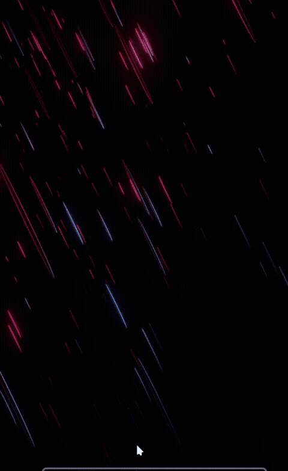

# CornerNote

A slim GTK quick-note overlay for KDE Plasma on Wayland — peek, type, and save to your Obsidian vault without leaving your flow.


## Features

- **Slide-in quick-note overlay**: peek from a screen edge, expand on hover or
  shortcut, and collapse without losing the current draft
- **Obsidian Markdown workflows**: save dated notes, append to existing files,
  choose vault folders, or leave the date off
- **History browser**: search the latest 500 vault notes and read their
  formatted contents without leaving the overlay
- **Markdown editing and preview**: format headings, bold, italic, and
  underline; preview lists, quotes, links, code, and other supported syntax
- **Appearance editor**: follow KDE or Pywal colors, choose built-in palettes,
  edit colors and fonts, or add a local image backdrop
- **Keyboard and display controls**: shortcuts, KDE global shortcut support,
  multi-monitor selection, edge position, size, and stacking options
- **Updates and recovery**: check or install fast-forward updates, opt into
  automatic updates, and restore the overlay after suspend/resume

> **Platform:** KDE Plasma 5.x / 6.x, Wayland session with `wlr-layer-shell`.  
> Does not support GNOME, X11, or non-layer-shell compositors.


[](docs/showcase.gif)

## Requirements

- KDE Plasma running a Wayland session with layer-shell support
- Python 3.10 or newer, PyGObject, GTK 3, Cairo, and gtk-layer-shell
- An Obsidian vault writable by your user

`install.sh` detects APT, DNF, Pacman, or Zypper and installs missing system
dependencies with that package manager (using `sudo` when needed). On systems
with other package managers, install the equivalent packages manually first.
To install them manually on Fedora:

```sh
sudo dnf install python3 python3-gobject python3-cairo gtk-layer-shell
```

The overlay cannot run as a layer-shell surface on X11. Check with
`printf '%s\n' "$XDG_SESSION_TYPE"` and use a Wayland Plasma session.

### Panels and stacking

On KWin, the layer-shell **top** layer can share its stacking layer with
Plasma panels. The **bottom** layer stays below panels and regular windows;
there is no layer-shell level that is guaranteed to sit above app windows but
below panels. The **Stacking** setting (`"layer"` in the config) picks the
behavior:

| Setting | Config value | Open note | Collapsed tab |
| --- | --- | --- | --- |
| Below panels and windows *(default)* | `bottom` | behind panels and windows | behind panels and windows |
| Above panels while open | `auto` | above panels and windows | behind panels and windows |
| Always above panels | `overlay` | above panels and windows | above panels and windows |

If a panel sits on the same screen edge as the note, the collapsed tab is
hidden behind it with the default setting. Either set **Y offset** to the
panel's thickness (for example `44` for a top panel, `-44` for a bottom one)
so the tab peeks out just past the panel, or choose **Always above panels**.
The default also puts the note behind regular app windows. Choose **Above
panels while open** to keep it above app windows while expanded.

KWin's `wlr-layer-shell` implementation has known quirks, and behavior may
differ between Plasma 5.x and 6.x. Check the [KDE bug tracker query for
`wlr-layer-shell`](https://bugs.kde.org/buglist.cgi?quicksearch=wlr-layer-shell)
for the current status.

**Krohnkite workaround:** Set CornerNote's **Stacking** mode to **Always above
panels** (`overlay`).

## Install

```sh
git clone --depth 1 https://github.com/ChecksMc/Cornernote-for-KDE-Plasma.git
cd Cornernote-for-KDE-Plasma
./install.sh
```

A shallow clone (`--depth 1`) skips old revisions of the README demo GIF and
still works with the built-in updater.

The installer installs missing dependencies when it recognizes your package
manager, then installs a user-level launcher and starts CornerNote through a
systemd user service when available, or KDE's login autostart otherwise. It
copies `config.example.json` to
`~/.config/cornernote/config.json` if no config exists, and enables the service
for the graphical session when systemd is available. Start the service with
`systemctl --user start cornernote` or run `~/.local/bin/cornernote-daemon` when
using login autostart. The daemon uses the current checkout, so keep this
repository in place after installing.

Remove the service and launchers with `./uninstall.sh`. This preserves your
settings by default; use `./uninstall.sh --purge-config` to delete them too.

Use `corner-note toggle` to open or close CornerNote. To bind a KDE global
shortcut, open **System Settings → Shortcuts → Add New → Command or URL** and
set the command to `corner-note toggle` with a shortcut such as Meta+N or F12.
This manual route works across Plasma versions.

## Updates

Open settings and expand **Updates**. Choose **Check for updates**, then
**Install update** when a newer revision is available. Checks and installation
run in the background so the editor stays responsive.

To enable automatic installation, select **Install updates automatically** and
click **Save settings**. This saves `"auto_update": true` in the config and
checks immediately, on subsequent daemon starts, and every six hours while
the daemon runs. Available updates are installed automatically. The setting is
off by default; no background network checks run while it is disabled. Manual
checks remain available.

The command-line client can also check and install updates while the daemon
is stopped:

```sh
corner-note check-update
corner-note update
```

Updates require Git and a CornerNote Git checkout on a branch with a configured
upstream. The updater fetches that branch's upstream and installs only a
fast-forward update. Installation refuses local changes, untracked files,
local commits ahead of upstream, divergent history, or an unfinished Git
operation. It never forces a reset and does not edit settings or vault files
outside the checkout. ZIP installations cannot use the built-in updater;
download the latest source and rerun `install.sh`, or switch to a Git clone.

After installation, CornerNote keeps running with your current draft. To use
the new version, save your note, then restart the daemon:

```sh
systemctl --user restart cornernote
```

For KDE login autostart installations, save your note, then log out and back
in. Updates never restart the daemon automatically; restarting clears any
unsaved in-memory draft.

## Use

- Hover the exposed paper tab to open it. Moving the pointer away collapses it.
- Press Meta+N (or your configured shortcut) to open and focus the note. The
  shortcut toggles the forced-open state.
- Enter in the title field moves focus to the note body.
- Submit normally to append a dated heading and draft to the configured
  quick-notes file. To append to another Markdown file, enter its path as the
  title or enable **Append mode**. A title ending in `.md` automatically
  selects append mode. Relative append paths resolve inside the configured
  vault; absolute `.md` paths are also accepted.
- Choose **No date** to omit the date from the saved heading. Typing `none` in
  the date field does the same. Custom dates such as `tomorrow` or `14.10` are
  still supported.
- Ctrl+Enter submits using the active mode.
- Ctrl+D toggles between a date and no date. Ctrl+Shift+D opens the date menu.
- Ctrl+Shift+A toggles append mode. Ctrl+Shift+F opens a Markdown-only picker
  to search for and append to an existing note in the vault.
- Ctrl+S toggles settings. The gear button also closes settings and returns to
  the editor. Settings collapse when the pointer leaves the overlay.
- **History** (Ctrl+H) browses the vault's latest 500 Markdown files, newest
  first. Search by filename or relative path, then select a file to read its
  formatted contents, including all appended entries. **Refresh** rescans the
  vault. Escape returns from a file to the list, then to your draft; the
  **Draft** button or Ctrl+H also returns to the editor. Browsing preserves
  unfinished text and submission options, and works across restarts.
- In the note body, Ctrl+1 inserts a level-one heading, Ctrl+B wraps text in
  bold markers, Ctrl+I wraps text in italic markers, and Ctrl+U wraps text in
  an HTML underline tag. The H1/B/I/U toolbar applies the same formatting.
  Headings, bold, italic, and underline appear styled while editing. Choose
  **Preview** (Ctrl+P) for a rendered view with the Markdown markers hidden;
  toggle it again to keep editing. Saving always preserves the Markdown.
  Preview also renders lists, quotes, links, strikethrough, and fenced/inline
  code. Other HTML and unsupported Markdown stay as text.
- Escape opens an inline discard confirmation. Confirm with Y/Yes or cancel
  with N/No/Escape.
- The gear button toggles between the editor and settings for the vault,
  filename/date format, timing, tab peek, appearance, and updates. Appearance
  changes are saved with **Apply style**; **Save settings** saves the other
  settings and returns to the editor.

Collapsing the overlay never clears a draft. A draft is cleared only after a
successful write or a confirmed discard. Write failures remain visible in the
overlay and preserve the text for retry.

## Configuration

Open the overlay and press the gear button for the in-app settings page, or
edit `${XDG_CONFIG_HOME:-~/.config}/cornernote/config.json` (normally
`~/.config/cornernote/config.json`). If `CORNERNOTE_CONFIG` is set, that file
is used instead. Settings are written atomically. The full template and
defaults are in [`config.example.json`](config.example.json). `note_filename` supports
`{date}` and `{title}` substitutions, for example `QuickNotes.md` or
`{date}.md`. Date tags accept `today`, `tomorrow`, weekday names, `in N days`,
and common numeric date forms. Position uses `position_horizontal` and
`position_vertical` (`left`/`center`/`right` and `top`/`center`/`bottom`);
`offset_x` and `offset_y` tune that reference point in pixels. Positive X
moves right and positive Y moves down. For top and bottom positions, the
outward Y offset is limited by the idle tab size so at least one pixel remains
visible when the note is collapsed. `monitor` selects `primary` or a
connected screen by its zero-based GDK display index; the settings page labels
each screen with its manufacturer, model, resolution, and desktop position,
truncating long labels with an ellipsis to keep the overlay width fixed.
The settings page also includes a folder chooser; under Plasma, GTK uses the
available KDE file chooser portal.

The default vault path is `~/Documents`. Change it in settings to the root of
your own Obsidian vault before saving notes.

Settings are grouped into display and position, vault and files, animation,
appearance, and updates sections. Expand **Appearance and style** to open the
embedded editor. It previews the style and offers Plasma colors, Pywal colors, ten
built-in palettes, editable custom colors (paper, text, accent, borders, editor
surface, buttons, and button text), installed font families and font size, a
local image backdrop, and rounded paper corners. With Plasma colors, buttons
follow the color scheme's button colors; built-in palettes use the editor
surface color. The **Submit** and **Save** buttons always use the accent
color. Configs saved before button colors existed keep their custom palette and
gain matching button colors automatically. The selected style is
saved to `config.json` and applied to the overlay. By default, colors follow
Plasma's `kdeglobals` palette, which CornerNote watches for changes. Text
contrast is corrected when a selected palette would make note text hard to
read. Settings also include independent note width and height controls. The
configured dimensions stay fixed when fonts change; smaller notes scroll to
keep oversized controls accessible. Applying a style or saving dimensions
resizes the current overlay immediately, without restarting the daemon.
The hide delay and slide duration are adjustable; defaults are 700 ms and 320 ms.

## Files

- `src/main.py` — GTK layer-shell overlay and daemon entry point
- `src/state.py` — draft buffer and note interaction state machine
- `src/style.py` — config, Pywal/KDE palette loading, and GTK CSS
- `src/settings_view.py` — settings controls, monitor choices, and vault folder picker
- `src/style_editor.py` — standalone appearance editor and live preview
- `src/ipc.py` — GLib-integrated Unix socket server and CLI client
- `src/obsidian.py` — safe Markdown path selection and append writer
- `src/markdown_render.py` — Markdown text and formatting ranges
- `src/markdown_view.py` — GTK formatting for the editor and rendered views
- `src/history.py` — saved vault note discovery and bounded read-only loading
- `src/history_view.py` — searchable saved-note browser and formatted viewer
- `src/updater.py` — Git upstream checks and fast-forward-only source updates
- `src/update_view.py` — manual update controls and opt-in automatic installation
- `corner-note` — IPC command-line client and standalone update commands
- `install.sh` — multi-distro dependency and user installation
- `uninstall.sh` — removes startup entries and launchers, optionally config
- `packaging/bundle.py` — builds a distributable `CornerNote.zip` (sources
  only; no docs media)

## Development and troubleshooting

Run `python3 src/main.py` from the checkout to see errors in a terminal. In a
second terminal use `./corner-note toggle`. Inspect service logs with
`journalctl --user -u cornernote -f`. The socket defaults to
`$XDG_RUNTIME_DIR/cornernote.sock`, which is private to the login session.

With **Above panels while open** (`auto`) stacking, the note moves to the
overlay layer after it finishes sliding open and back to the bottom layer as
soon as it starts to collapse. The default **Below panels and windows** mode
stays below both throughout. See [Panels and stacking](#panels-and-stacking).
Fullscreen handling depends on KWin's layer-shell policy; the app does not poll
KWin state.

CornerNote listens for systemd-logind sleep and wake notifications. On resume it
recreates the Wayland layer surface and reapplies the selected screen and
position, keeping the in-memory draft intact. If the system bus is unavailable,
the overlay continues to run normally but cannot perform this resume recovery.

## Roadmap / Known Limitations

GTK 3 is in maintenance mode. The roadmap is to move CornerNote to Qt and grow
desktop support through tested platform integrations:

- **v2.0.0 — Qt and cross-desktop foundations:** port the current KDE interface
  to Qt, separate desktop/compositor-specific behavior from the core app, and
  publish a support matrix for tested desktop and window-manager combinations.
  Add combinations incrementally; a Qt port by itself does not guarantee that
  every compositor supports CornerNote's overlay behavior.
- **v2.1.0 — Draft tabs and recovery:** keep multiple independent drafts open
  and switch between them. Add local autosave and recovery so drafts survive
  restarts and crashes without silently writing unfinished text into the vault.
- **v3.0.0 — Edit saved files from History:** turn the read-only history view
  into an editor for existing Markdown files, with explicit saves and safeguards
  for files changed outside CornerNote.
- **v3.1.0 — Autosave edited files:** extend autosave to edits of saved vault
  notes, building on the file-editing workflow introduced in v3.0.0.
- **v4.0.0 — Optional Focus mode:** add a focus timer in the top bar, a
  lightweight to-do list, and a compact calendar view for dated tasks.

## Known Issues

**Overlay disappears after suspend/resume**
On some systems the layer-shell surface is not automatically recreated after
waking from suspend. The service continues running normally but the overlay
is no longer visible. Workaround until this is resolved:

```bash
    systemctl --user restart cornernote
```

This is a Wayland compositor surface lifecycle issue and may affect other
layer-shell applications on the same setup. Multi-monitor and hybrid GPU
configurations appear more likely to trigger it.

